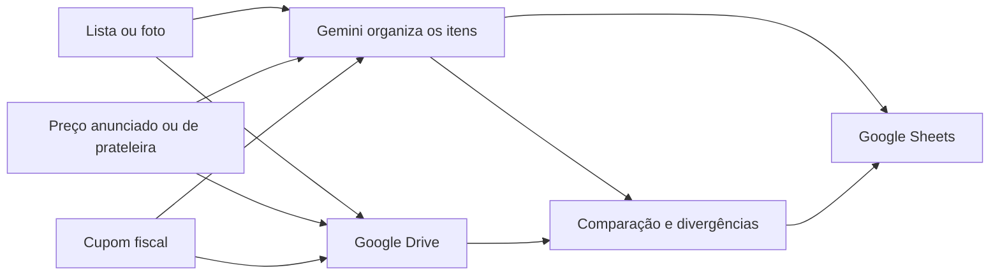

# Fiscal de Compras e Preços

Durante uma compra, o preço pode aparecer de três formas: no anúncio, na prateleira e no cupom fiscal. Quando os valores não coincidem, conferir tudo manualmente dá trabalho e a diferença pode passar despercebida.

Criei este MVP para organizar esse processo. O assistente recebe fotos da lista, dos preços e do cupom, estrutura os itens, compara os valores e mantém um histórico no Google Sheets. As imagens ficam no Google Drive como evidência da conferência.

O projeto foi aplicado com um **Gem do Gemini**, uma planilha no **Google Sheets** e pastas no **Google Drive**. Este repositório documenta a solução e usa somente dados fictícios. Cupons, listas, planilhas e links reais não são publicados.

## O que o MVP faz

- lê listas de compras manuscritas ou impressas;
- extrai produtos de etiquetas, anúncios e cupons fiscais;
- registra quantidade, marca, preço anunciado, preço de prateleira e preço cobrado;
- calcula o total durante a compra;
- aponta promoções que podem não ter sido aplicadas;
- identifica itens duplicados ou que não estavam na lista original;
- mantém um histórico de preços por produto, loja e data;
- preserva a imagem original como evidência, sem levar dados pessoais para a base pública.

Quando uma informação não está legível, o assistente marca **Precisa confirmar**. Quando existe diferença, mas a evidência ainda não é suficiente, registra **Divergência provável**. A automação ajuda na conferência, mas não transforma uma leitura incerta em acusação.

## Como funciona

O fluxo usado foi:

1. fotografar ou enviar a lista;
2. registrar os preços encontrados na loja;
3. enviar a foto do cupom;
4. comparar o anunciado, o valor da prateleira e o valor cobrado;
5. salvar o resultado e atualizar o histórico de preços.

## Organização da planilha

A base foi dividida para não misturar a compra, os itens e as divergências:

| Aba | Finalidade |
| --- | --- |
| `Compras` | Identifica a compra e reúne os totais |
| `Itens` | Guarda cada produto e os três preços comparáveis |
| `Historico_Precos` | Permite consultar a evolução do preço |
| `Divergencias` | Registra o que precisa ser conferido |
| `Supermercados` | Padroniza lojas e unidades |
| `Categorias` | Padroniza os grupos de produtos |
| `Abreviacoes_Cupom` | Ajuda a interpretar descrições reduzidas |
| `Regras_Comparacao` | Mantém os critérios da auditoria |

O modelo completo está em [docs/modelo-de-dados.md](docs/modelo-de-dados.md). Os arquivos em [examples](examples) mostram como a exportação funciona com dados inventados.

## Decisões que fizeram diferença

- **Planilha como base principal:** era simples de consultar, corrigir e compartilhar sem criar um sistema maior do que o problema.
- **Drive para as evidências:** a planilha guarda os registros e aponta para a imagem usada na conferência.
- **Gemini para leitura e organização:** o Gem recebeu regras específicas para interpretar imagens e devolver dados compatíveis com a planilha.
- **Sem inventar valores:** qualquer leitura duvidosa volta para conferência humana.
- **Promoções condicionais ficam registradas:** aplicativo, CPF, clube, quantidade mínima e ofertas do tipo leve e pague mudam a comparação.
- **Privacidade desde a entrada:** CPF e outros dados pessoais não fazem parte da análise.

As escolhas e os limites atuais estão detalhados em [docs/decisoes.md](docs/decisoes.md) e [docs/limitacoes.md](docs/limitacoes.md).

## Engenharia de prompt

As instruções do Gem foram organizadas em torno de tarefas concretas: identificar a origem da imagem, extrair sem completar lacunas, normalizar descrições sem apagar o texto original, calcular, comparar e devolver uma saída compatível com a planilha.

Também separei estados que parecem semelhantes, mas exigem tratamentos diferentes: **OK**, **Precisa confirmar**, **Promoção não identificada** e **Divergência provável**. Essa separação reduziu respostas categóricas quando a imagem não sustentava uma conclusão.

O desenho das instruções está resumido em [docs/engenharia-de-prompt.md](docs/engenharia-de-prompt.md).

## Situação atual

O MVP já tem a estrutura de dados, as regras de comparação e o fluxo entre Gemini, Google Sheets e Google Drive. A planilha foi montada para receber os registros e gerar um histórico consultável.

Os próximos testes devem medir a leitura de diferentes formatos de cupom, promoções condicionais, produtos vendidos por peso e a taxa de itens que ainda precisam de confirmação manual.

## Documentação

- [Arquitetura](docs/arquitetura.md)
- [Regras de comparação](docs/regras-de-comparacao.md)
- [Modelo de dados](docs/modelo-de-dados.md)
- [Engenharia de prompt](docs/engenharia-de-prompt.md)
- [Decisões](docs/decisoes.md)
- [Limitações e próximos testes](docs/limitacoes.md)
- [Segurança e privacidade](SECURITY.md)

## Capa da planilha relacionada: Minhas Compras

A planilha pessoal de controle não é uma automação de gastos. Esta arte é independente dos dados da planilha e pode ser usada na área de projetos do LinkedIn.

## Licença

A documentação e os exemplos deste repositório podem ser usados como referência. Os dados pessoais, cupons, listas e planilhas reais não fazem parte do projeto público.
