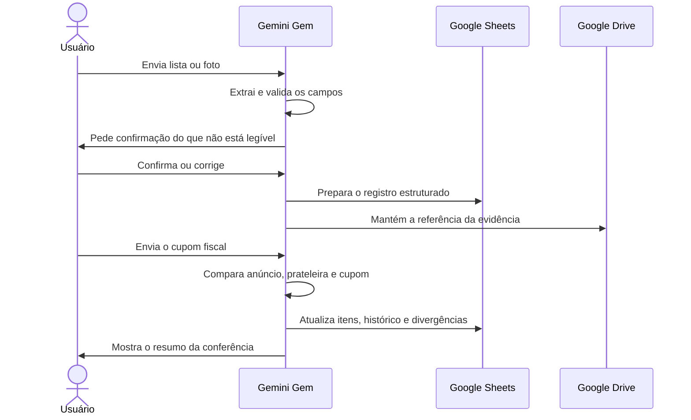

# Arquitetura

O MVP usa serviços que já faziam parte da rotina. A intenção foi validar o processo antes de transformar a ideia em um aplicativo próprio.

## Componentes

### Gemini Gem

Recebe as imagens e o pedido do usuário. Identifica se o material é uma lista, uma etiqueta, um anúncio ou um cupom. Depois extrai os campos, normaliza os nomes, calcula e classifica o resultado.

### Google Sheets

É a base de dados do MVP. Separa compras, itens, histórico e divergências em abas próprias. Isso permite corrigir uma leitura e acompanhar os cálculos sem depender de uma interface nova.

### Google Drive

Guarda as fotos e os comprovantes. A planilha pode manter uma referência à evidência, mas os arquivos privados não são copiados para este repositório.

## Fluxo dos dados

## Separação das responsabilidades

O Gemini interpreta e organiza. A planilha mantém o estado. O Drive preserva a evidência. A conferência humana resolve o que a imagem ou a regra não permitem concluir.

Essa separação facilita substituir uma parte no futuro. Um aplicativo próprio poderá consumir a mesma estrutura sem exigir a perda do histórico já organizado.
